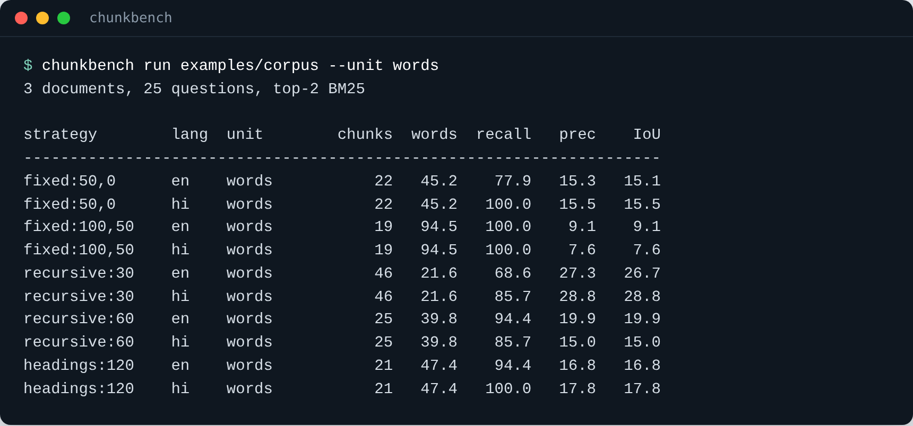

# chunkbench

Before you pick a chunk size for a RAG system, measure it on your own documents.
chunkbench chunks a folder of markdown with several strategies, retrieves with BM25 for
each labelled question, and reports how much of the right text came back (recall) and how
much padding came with it (precision, IoU). It runs offline in under a second, with no
embeddings and no keys.



```bash
pip install git+https://github.com/yashere69/chunkbench
chunkbench run examples/corpus
chunkbench run my-docs/ --questions my-questions.yaml --strategy recursive:80 --strategy headings:200
```

## The metric

The scoring follows Chroma's [chunking evaluation](https://research.trychroma.com/evaluating-chunking)
(Smith & Troynikov, 2024). A question is labelled with the *excerpts* that answer it, quoted
verbatim from the document, not with a chunk id. That's what makes strategies with
different boundaries comparable. For each question:

- **recall**: share of the excerpt's units that appear in the retrieved chunks
- **precision**: excerpt units retrieved ÷ all units retrieved, counting overlapped text
  every time it comes back
- **IoU**: excerpt units retrieved ÷ (excerpt + retrieved − excerpt units retrieved)

Recall alone always favours big chunks: retrieve the whole document and recall is 100%.
IoU is what tells you how much irrelevant text you're paying for in the prompt.

## What the sample corpus shows

`examples/corpus` holds three short policy documents for a fictional store, two in English
and one in Hindi, with 25 questions. Top-2 retrieval, units counted in words:

| Strategy | Avg words/chunk | Recall (en / hi) | IoU (en / hi) |
|---|---|---|---|
| fixed:50,0 | 45 | 77.9 / 100 | 15.1 / 15.5 |
| fixed:100,50 | 95 | 100 / 100 | 9.1 / 7.6 |
| recursive:30 | 22 | 68.6 / 85.7 | 26.7 / 28.8 |
| recursive:60 | 40 | 94.4 / 85.7 | 19.9 / 15.0 |
| headings:120 | 47 | 94.4 / 100 | 16.8 / 17.8 |

Full output: [results/sample.txt](results/sample.txt). On these documents, splitting on
headings gives nearly the recall of 100-word overlapping windows at about twice the IoU,
because the documents are already sectioned by topic. Overlap is the worst deal here: it
buys a few points of recall and pays for them with repeated text. Your documents will
differ, and that's the reason to run it on them.

The corpus is small, I wrote both the documents and the questions, and with only 7 Hindi
questions one question moves the Hindi numbers by 14 points. Treat this as a worked
example, not a finding about chunking in general.

## Units, and Hindi

Precision and IoU depend on what you count. Whitespace words, code points, and grapheme
clusters (what a reader sees as one character, so क्ष counts as one and not three)
give different totals in Devanagari. `--unit graphemes` and `--unit chars` let you check
whether that changes your ranking. On this corpus it doesn't: the unit moves IoU by under a
point, while strategy and size move it by 20. That's worth knowing, because it means
word-level numbers are safe here. For scripts written without spaces (Thai, Khmer),
word-level counting breaks, and the grapheme unit is the one to use.

Two Hindi details needed explicit handling:

- The recursive splitter treats the danda (।) as a sentence end.
- Python's `\w` doesn't match Devanagari vowel signs, so a naive tokenizer cuts
  किताब into pieces and BM25 never matches it. Both the BM25 tokenizer and the grapheme
  unit handle combining marks explicitly.

## Strategies

| Spec | What it does |
|---|---|
| `fixed:N,O` | windows of N words, O words of overlap |
| `recursive:N` | split on paragraph, line, sentence (incl. ।), clause, then word, and merge pieces up to N words |
| `headings:N` | one chunk per markdown section, recursive inside sections longer than N |

Sizes are in whitespace words for every strategy, so `recursive:60` and `fixed:60,0` are
the same size. Chunks are character spans into the original text rather than copied
strings, which is what lets the metrics intersect them exactly with the excerpts.

## Question file

```yaml
- q: Can I return a dupatta bought on sale?
  doc: shipping-and-returns.md
  excerpts: ["Some things cannot be returned: dupattas bought on sale, ..."]
- q: मुफ़्त शिपिंग कितने के ऑर्डर पर है?
  doc: niti-hindi.md
  lang: hi
  excerpts: ["₹1,499 से ऊपर के प्रीपेड ऑर्डर पर शिपिंग मुफ़्त है।"]
```

Every excerpt must appear verbatim in its document, and chunkbench stops with an error if
one doesn't. That catches labels drifting out of date when a document is edited.

## Related work and limits

- [chunkr's benchmark PR](https://github.com/d1pankarmedhi/chunkr/pull/6) runs Chroma's
  own five-corpus, 472-question benchmark across popular chunking libraries. Use that to
  compare libraries on a standard set; use this to compare settings on your own documents.
- BM25 only. Embedding retrieval changes which chunks come back, so the best strategy
  under BM25 may not be the best under embeddings. Adding a pluggable retriever is the
  next step.
- No semantic or LLM-based chunkers.

MIT licensed.
